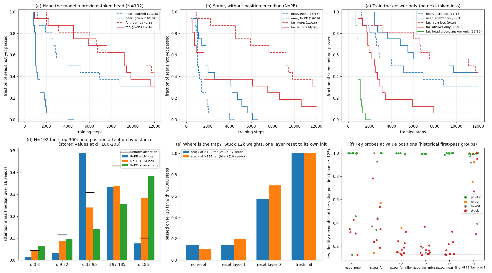

# Task B · Transformer 何时学会利用远处信息？

一个围绕合成键值检索的受控实验：区分模型**无法访问远处信息、可访问但没有学会使用、训练预算不足**。主要发现是，在所测小模型中，位置编码、训练目标与训练路径共同影响远处检索能否形成。

**先读 [技术报告](REPORT.md)**；完整数字见 [结果表](RESULTS.md)，原始假设与判断变化见 [实验协议](docs/PROTOCOL.md) 和 [决策日志](docs/DECISIONS.md)。



## 目录

| 路径 | 内容 |
|---|---|
| `REPORT.md` | 问题、假设、受控实验、失败、结论与局限 |
| `RESULTS.md` | 从保存的评估记录生成的完整结果 |
| `synth/` | 数据、Transformer、训练、诊断与测试 |
| `synth/runs/` | 每次运行的配置、逐 seed 评估轨迹与最终指标 |
| `synth/results/` | 已保存的消融、探针和外推结果 |
| `docs/` | 历史实验协议与决策日志 |
| `pretrained/` | Pythia / Qwen 补充评测，不用于证明合成实验的机制 |

## 安装与快速检查

在本仓库根目录运行。使用 Python 3.10+；原实验使用 PyTorch 2.7.1、CUDA 12.6 和 A100。

```bash
python -m pip install -r requirements.txt
python -m pytest -q synth/
python synth/show_task.py --N 6 --post_lo 2 --post_hi 2
```

## 复现

**只重建图表，不训练、不需要 GPU 或权重：**

```bash
python synth/figures.py
python pretrained/figures.py
python build_results.py
```

**重跑报告中的关键对照：**

```bash
# 查看配置和实际执行命令
python synth/reproduce.py --list
python synth/reproduce.py --runs S1_N192_far X6_N192_far_answeronly --dry-run

# 同一 GPU 顺序执行；每组 16 个 seed，结果写入 artifacts/runs/
python synth/reproduce.py --runs S1_N192_far X6_N192_far_answeronly --device cuda:0
```

`reproduce.py` 读取原运行配置；迁移或续训实验会自动先运行其依赖。用 `--all` 重跑全部配置，`--out` 指定新输出目录。重跑不会覆盖提交的评估记录。原实验使用 TF32 与 `torch.compile`，不保证逐位重现；结论基于多 seed 分布，历史手动中止的运行可能与重跑的停止时刻不同。

**快速训练示例：**

```bash
python synth/train.py --name demo --N 16 --post_lo 8 --post_hi 16 \
  --E 4 --steps 1500 --device cuda:0 --out artifacts/runs
```

诊断示例（先重跑对应实验以获得权重）：

```bash
python synth/mechanism.py --ckpt artifacts/runs/S1_N192_far/final.pt \
  --target N192_far --device cuda:0 --out artifacts/binding.json
python synth/ablate.py --ckpt artifacts/runs/S1_N192_far/final.pt \
  --target N192_far --device cuda:0 --out artifacts/ablation.json
```

仓库保留数值证据，不包含模型权重、下载缓存和终端日志。`synth/runs/*/log.jsonl` 是绘图所需的结构化评估数据，包含成功和失败的全部 seed。`t_pass` 表示首次达标；结果表另外报告最终 checkpoint 的达标数，两者不能混用。
